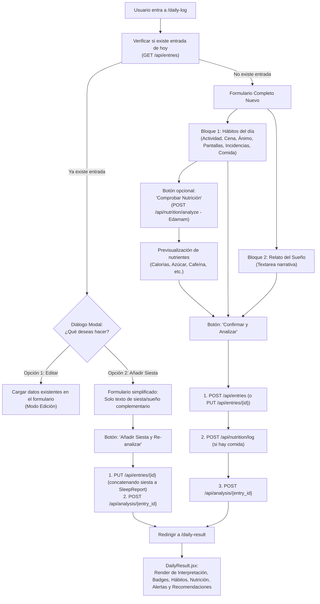

# Plan: UI Completa del Registro Diario (DailyLog → NutritionLog → DailyResult)

## Objetivo
Implementar la interfaz completa en `DailyLog.jsx` para la toma de datos estructurada (`SleepReport` y `HabitLog`), enriquecimiento nutricional previo vía Edamam (`/api/nutrition/analyze` y `/api/nutrition/log`), gestión de entradas existentes para el día (modo edición o adición de siesta sin sobreescribir otros datos), orquestación del análisis IA vía OpenRouter (`/api/analysis/{id}`), y renderizado detallado en `DailyResult.jsx`.

---

## 📋 Requerimientos y Acuerdos Confirmados

1. **Voz / Whisper:** 
   - ❌ **No se implementa**. No se incluye botón de grabación ni endpoint de Whisper en esta fase. La entrada del sueño es puramente textual.
2. **Entradas Duplicadas del Mismo Día (Detección y Manejo de Siesta):**
   - Al entrar a `DailyLog`, se comprueba si ya existe una entrada para el día de hoy (`GET /api/entries`).
   - Si ya existe una entrada previa:
     - Se muestra un modal/diálogo informativo al usuario con dos opciones:
       1. **Editar/Sobrescribir la entrada existente**.
       2. **Añadir siesta/sueño complementario:** Si el usuario elige esta opción, solo se añade el nuevo texto al `SleepReport.raw_text` (formateado explícitamente como: `"\n\n[Siesta / Registro complementario]: " + texto_siesta`) para que el LLM lo interprete en su análisis. **No se alteran ni sobreescriben** los hábitos, tiempos de pantalla, ni datos nutricionales ya registrados.
3. **Clave de IA (OpenRouter):**
   - ✅ Añadida a `.env` (`OPENROUTER_API_KEY`).
   - Conectada al servicio de orquestación `POST /api/analysis/{entry_id}`.

---

## 🔄 Flujo de Datos y Componentes

---

## 🛠️ Especificación Técnica Detallada de Cambios

### 1. `src/api/blueprints/daily_entries_bp/routes.py` (Backend)
- **Añadir endpoint `PUT /api/entries/<int:entry_id>`**:
  - Permite actualizar campos de `SleepReport` (por ejemplo `raw_text` para concatenar la siesta) y `HabitLog` si se edita.
  - Verifica propiedad (`user_id == current_user_id`).
  - Devuelve el `DailyEntry` actualizado.

### 2. `DailyLog.jsx` (Frontend)

#### A. Estado y Detección de Entrada Previa
- `useEffect` inicial llama a `GET /api/entries` y busca si hay un elemento con `entry_date === today`.
- Si existe:
  - Activa estado `existingEntryModal = true` guardando la referencia a `existingEntry`.
  - El usuario puede elegir:
    - **"Añadir siesta"**: Entra en modo `mode = 'nap'`. Solo muestra el campo para redactar la siesta.
    - **"Editar registro completo"**: Entra en modo `mode = 'edit'`. Pre-rellena los estados con los datos de `existingEntry`.
    - **"Ver resultado actual"**: Navega a `/daily-result`.

#### B. Campos Estructurados de Hábitos (`HabitLog`)
- **Actividad física (`physical_activity`):** Select con `nada`, `baja`, `media`, `alta`.
- **Tipo de cena (`dinner_type`):** Select con `nada`, `ligera`, `media`, `pesada`.
- **Sensación antes de dormir (`bedtime_mood`):** Select con `cansada`, `estresada`, `relajada`, `triste`, `alegre`.
- **Tiempo de pantallas (`screen_time`):** Select con `ninguna`, `menos_1h`, `1_2h`, `mas_2h`.
- **Incidencias puntuales (`incidents`):** Selector múltiple / tags: `accidente`, `buenas_noticias`, `malas_noticias`, `premios`, `multas`, `ninguna`.
- **Comida/Cena consumida (`food_notes`):** Textarea con placeholder instructivo (ej: *"1 taza de café, ensalada con atún, 100g de arroz"*).

#### C. Integración Nutricional (Edamam)
- Botón **"Calcular Nutrición"**:
  - Llama a `POST /api/nutrition/analyze` con `{ query: foodNotes, meal_type: dinnerType }`.
  - Muestra tarjetas de resumen: Calorías (kcal), Cafeína (mg), Azúcares (g), Proteínas (g), Alcohol (g).
  - Permite al usuario verificar los valores antes de guardar.

#### D. Envío y Orquestación
- Al presionar **"Confirmar y Analizar"**:
  1. Si `mode === 'nap'`:
     - Concatena: `existingEntry.sleep_report.raw_text + "\n\n[Siesta / Registro complementario]: " + napText`.
     - Llama a `PUT /api/entries/{existingEntry.id}` con el nuevo `raw_text` de sleep_report.
     - Llama a `POST /api/analysis/{existingEntry.id}` para regenerar el análisis unificado.
  2. Si `mode === 'new'`:
     - Crea la entrada con `POST /api/entries`.
     - Si hay `foodNotes`, llama a `POST /api/nutrition/log` con `{ entry_id, ingredients: [foodNotes], meal_type: dinnerType }`.
     - Llama a `POST /api/analysis/{entry_id}`.
  3. Si `mode === 'edit'`:
     - Actualiza con `PUT /api/entries/{existingEntry.id}`.
     - Si se modificó la comida, actualiza `POST /api/nutrition/log`.
     - Llama a `POST /api/analysis/{existingEntry.id}`.
  4. Redirige a `/daily-result`.

---

### 3. `DailyResult.jsx` (Frontend)

Renderizado visual completo siguiendo el *Esquema Integral*:

1. **Encabezado y Metadatos:** Fecha y estado del día.
2. **Interpretación Onírica e IA:**
   - Tarjeta destacada con `analysis.interpretation`.
   - Badges de color para `analysis.predominant_emotions` (ej: ansiedad, calma, alegría).
   - Badges para `analysis.detected_symbols` (ej: agua, persecución, caída).
3. **Capa Explicativa (Hábitos y Nutrición):**
   - Tarjeta informativa con `analysis.habits_reading`.
   - Resumen visual de los hábitos (`physical_activity`, `dinner_type`, `bedtime_mood`, `screen_time`, `incidents`).
   - Indicadores nutricionales de `entry.nutrition_log` (Calorías, Cafeína, Azúcares, Alcohol).
4. **Patrones y Recomendaciones:**
   - Bloque de `analysis.patterns_detected`.
   - Lista priorizada de `analysis.recommendations` en tarjetas visuales.
   - Bloque de `analysis.alerts` con estilo de alerta Bootstrap (`alert-warning` o `alert-danger`).
5. **Relato Original:** Desplegable / tarjeta con `sleep_report.raw_text` (incluyendo notas de siesta si las hubo).

---

## 📋 Plan de Verificación

1. **Flujo de Usuario Nuevo:**
   - Llenar hábitos completos + relato del sueño + notas de comida.
   - Probar botón "Calcular Nutrición" → verificar que Edamam responde con calorías/cafeína.
   - Presionar "Confirmar y Analizar" → verificar creación de entrada, guardado nutricional y llamada a OpenRouter.
   - Verificar redirección a `/daily-result` y presentación de tarjetas, badges y alertas.
2. **Flujo de Siesta / Entrada Duplicada:**
   - Volver a entrar a `/daily-log` el mismo día.
   - Verificar que aparece el modal de aviso.
   - Seleccionar "Añadir Siesta": verificar que el formulario solo pide la siesta.
   - Enviar y verificar que se re-analiza y que en el resultado final el relato contiene tanto el sueño nocturno como la siesta, manteniendo intactos los datos de hábitos/nutrición.

